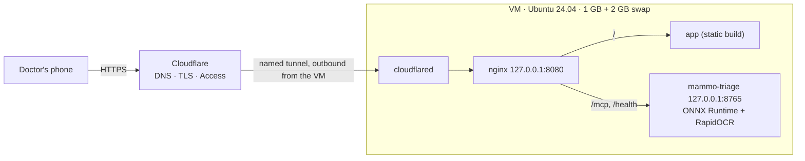

# Deploy on a small VM (Azure B2ats v2, 1 GB) with a Cloudflare named tunnel

The ONNX server, the app and nginx run on one Ubuntu 24.04 VM with no public ports. Cloudflare brings the traffic in
through a named tunnel and Cloudflare Access decides who gets in. One origin serves everything:
`https://app.mammotriage.com/` is the app and `/mcp` is the server, so the browser needs no CORS and the doctor logs
in once.



| File | Purpose |
|---|---|
| `setup.sh` | Runs on the VM as root: swap, packages, cloudflared, venv, bundle, key, service, nginx, tunnel. Idempotent |
| `push.sh` | Runs on your computer: uploads the committed server, the app build, the bundle and the tunnel files, then runs `setup.sh` |
| `mammo-triage.service` | systemd unit, unprivileged user and hardening |
| `nginx-mammotriage.conf` | One origin for the app and the server, on loopback |
| `constraints.txt` | Package versions tested with the ONNX backend |

## 1. Create the VM (Azure portal)

- Image: Ubuntu Server 24.04 LTS (x64). Size: `Standard_B2ats_v2` (in the free services for 12 months).
- Authentication: SSH public key (generate it with `ssh-keygen -t ed25519 -f ~/.ssh/mammotriage_vm`).
- Inbound ports: SSH only, **restricted to your own public IP**. It is closed again at the end (step 7).
- OS disk: Premium SSD **64 GiB** (P6, the size in the free services). No data disks.
- Check the cost estimate the portal shows before creating it, and set a budget alert in Cost Management.

## 2. Build the app for the domain

In `ai-mammogram-triage-app`, build with the server on the same origin:

```bash
VITE_DEFAULT_SERVER_URL=https://app.mammotriage.com/mcp npm run build
```

## 3. Export the ONNX bundle

`export_onnx.py` in the training repository (`bundles/v1-onnx`). It is private: it travels only by SSH to the VM.

## 4. First deployment (no tunnel yet)

```bash
deploy/azure-vm/push.sh <vm-ip> <path>/bundles/v1-onnx <path>/ai-mammogram-triage-app/dist
```

It ends with the server's `/health`, the app's HTTP status through nginx and the memory in use.

## 5. Named tunnel (on your computer)

```bash
cloudflared tunnel login
```

It opens Cloudflare in the browser: choose the `mammotriage.com` zone. Then:

```bash
cloudflared tunnel create mammo-vm
```

```bash
cloudflared tunnel route dns mammo-vm app.mammotriage.com
```

Put `config.yml` next to the credentials file that `create` wrote (`<tunnel id>.json`) in a private folder outside
git:

```yaml
tunnel: <tunnel id>
credentials-file: /etc/cloudflared/<tunnel id>.json
ingress:
  - hostname: app.mammotriage.com
    service: http://127.0.0.1:8080
    # Once Cloudflare Access is set up (step 6): cloudflared also checks the Access token before proxying, a
    # second check independent of the server's (ADR 0006).
    originRequest:
      access:
        required: true
        teamName: <team name, e.g. myteam for myteam.cloudflareaccess.com>
        audTag: [<AUD tag of the application>]
  - service: http_status:404
```

Deploy again with that folder as the fourth argument of `push.sh`. `setup.sh` installs cloudflared as a service.

## 6. Cloudflare Access

Zero Trust → Access controls → Applications → Self-hosted: `app.mammotriage.com`, policy "Allow" for the doctors' emails
(one-time code by email: add **One-time PIN** as a login method and make it the application's only one). The app and
`/mcp` share the origin, so the Access cookie covers both.

So that doctors need no API key ([ADR 0006](../../docs/adr/0006-cloudflare-access-identity.md)), put `access.env`
next to `config.yml` in the private tunnel folder and deploy again:

```bash
MAMMO_ACCESS_TEAM_DOMAIN=<team>.cloudflareaccess.com
MAMMO_ACCESS_AUD=<AUD tag of the application: Access controls → Applications → app → Additional settings>
```

The API key stays for technical clients: read it on the VM with `sudo grep MAMMO_API_KEY /etc/mammo-triage/env`.

## 7. Close SSH

Delete the SSH inbound rule of the VM's network security group. To deploy again, add it back for your IP for the
duration of the deployment.

## Operation

- Logs: `journalctl -u mammo-triage -f` and `journalctl -u cloudflared -f`.
- Rotate the key: delete `/etc/mammo-triage/env` and run `setup.sh` again (it generates a new one).
- Security updates install themselves (`unattended-upgrades`). Reboot the VM now and then for kernel updates.
- After 30 days, a free trial account must be upgraded to pay-as-you-go to keep the 12 months of free services.
