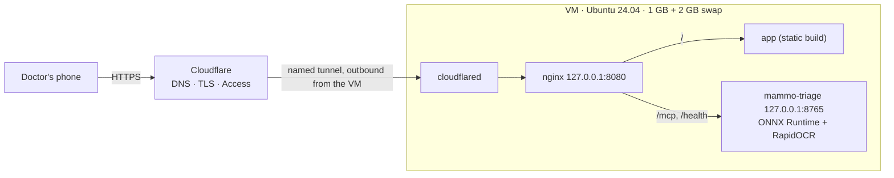
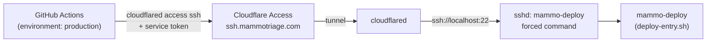

# Deploy on a small VM (Azure B2ats v2, 1 GB) with a Cloudflare named tunnel

The ONNX server, the app and nginx run on one Ubuntu 24.04 VM with no public ports. Cloudflare brings the traffic in
through a named tunnel and Cloudflare Access decides who gets in. One origin serves everything:
`https://app.mammotriage.com/` is the app and `/mcp` is the server, so the browser needs no CORS and the doctor logs
in once.



| File | Purpose |
|---|---|
| `setup.sh` | Runs on the VM as root: swap, packages, cloudflared, venv, bundle, key, service, nginx, tunnel. Idempotent |
| `push.sh` | Runs on your computer: uploads the committed server, the app build, the bundle and the tunnel files, then runs `setup.sh` |
| `mammo-triage.service` | systemd unit, unprivileged user and hardening |
| `nginx-mammotriage.conf` | One origin for the app and the server, on loopback |
| `constraints.txt` | Package versions tested with the ONNX backend |
| `deploy-entry.sh` | The only program the GitHub Actions deploy key can run on the VM (automatic deployment) |

## 1. Create the VM (Azure portal)

- Image: Ubuntu Server 24.04 LTS (x64). Size: `Standard_B2ats_v2` (in the free services for 12 months).
- Authentication: SSH public key (generate it with `ssh-keygen -t ed25519 -f ~/.ssh/mammotriage_vm`).
- Inbound ports: SSH only, **restricted to your own public IP**. It is closed again at the end (step 7).
- OS disk: Premium SSD **64 GiB** (P6, the size in the free services). No data disks.
- Check the cost estimate the portal shows before creating it, and set a budget alert in Cost Management.

## 2. Build the app for the domain

In `ai-mammogram-triage-app`, build with the server on the same origin:

```bash
VITE_DEFAULT_SERVER_URL=https://app.mammotriage.com/mcp npm run build
```

## 3. Export the ONNX bundle

`export_onnx.py` in the training repository (`bundles/v1-onnx`). It is private: it travels only by SSH to the VM.

## 4. First deployment (no tunnel yet)

```bash
deploy/azure-vm/push.sh <vm-ip> <path>/bundles/v1-onnx <path>/ai-mammogram-triage-app/dist
```

It ends with the server's `/health`, the app's HTTP status through nginx and the memory in use.

## 5. Named tunnel (on your computer)

```bash
cloudflared tunnel login
```

It opens Cloudflare in the browser: choose the `mammotriage.com` zone. Then:

```bash
cloudflared tunnel create mammo-vm
```

```bash
cloudflared tunnel route dns mammo-vm app.mammotriage.com
```

Put `config.yml` next to the credentials file that `create` wrote (`<tunnel id>.json`) in a private folder outside
git:

```yaml
tunnel: <tunnel id>
credentials-file: /etc/cloudflared/<tunnel id>.json
ingress:
  - hostname: app.mammotriage.com
    service: http://127.0.0.1:8080
    # Once Cloudflare Access is set up (step 6): cloudflared also checks the Access token before proxying, a
    # second check independent of the server's (ADR 0006).
    originRequest:
      access:
        required: true
        teamName: <team name, e.g. myteam for myteam.cloudflareaccess.com>
        audTag: [<AUD tag of the application>]
  - service: http_status:404
```

Deploy again with that folder as the fourth argument of `push.sh`. `setup.sh` installs cloudflared as a service.

## 6. Cloudflare Access

Zero Trust → Access controls → Applications → Self-hosted: `app.mammotriage.com`, policy "Allow" for the doctors' emails
(one-time code by email: add **One-time PIN** as a login method and make it the application's only one). The app and
`/mcp` share the origin, so the Access cookie covers both.

So that doctors need no API key ([ADR 0006](../../docs/adr/0006-cloudflare-access-identity.md)), put `access.env`
next to `config.yml` in the private tunnel folder and deploy again:

```bash
MAMMO_ACCESS_TEAM_DOMAIN=<team>.cloudflareaccess.com
MAMMO_ACCESS_AUD=<AUD tag of the application: Access controls → Applications → app → Additional settings>
# Optional: who may see the anonymous usage report at https://<domain>/usage (comma-separated)
MAMMO_ADMIN_EMAILS=<your Access e-mail>
```

`setup.sh` also sets `MAMMO_USAGE_FILE=/var/lib/mammo-triage/usage.json`, in the only folder the service may write
(`StateDirectory` in `mammo-triage.service`). The counters are numbers per day; nothing personal is kept
([security-and-privacy.md](../../docs/security-and-privacy.md)).

The API key stays for technical clients: read it on the VM with `sudo grep MAMMO_API_KEY /etc/mammo-triage/env`.

## Trying a new gate in shadow mode

To compare a new "is it a mammogram?" gate with the one in use on what doctors actually upload, deploy with the
current bundle and pass the new one as `SHADOW_GATE_BUNDLE`:

```bash
SHADOW_GATE_BUNDLE=<path>/bundles/v1.1.0-onnx deploy/azure-vm/push.sh <vm-ip> <path>/bundles/v1-onnx <app dist> <tunnel folder>
```

The gate in use keeps deciding; the new one only judges, and `/usage` shows per day the views both judged and those
where only one of them accepts. Nothing about the images is kept. When the numbers support it, deploy the new bundle
as the main one without `SHADOW_GATE_BUNDLE` (that also turns shadow mode off). A gate the server does not know how to
run (a newer version) stops the service at startup instead of running wrongly.

## 7. Close SSH

Delete the SSH inbound rule of the VM's network security group. To run `push.sh` again, add it back for your IP
(Source: **My IP address**, not *Any*) for the duration of the deployment.

## Automatic deployment

Once this is set up, merging to `main` deploys: `.github/workflows/deploy.yml` in this repository (the server) and in
`ai-mammogram-triage-app` (the app) run after a green CI run on `main`. They reach SSH **through the tunnel**, so no
port opens in Azure:



Three locks guard it: Cloudflare Access admits only the service token, cloudflared checks the Access token again
before reaching sshd, and the deploy key can run only `deploy-entry.sh`: `version`, `app <commit>` (checks the
build's CSP, swaps the static files keeping the previous build's assets one more release for pages still open, rolls
back if nginx does not serve the new ones) and `server <commit>` (installs
the wheel built by the workflow, restarts the service and, if the install or `/health` fails, puts every package back
as it was). Once the upload is in, it writes to `/var/lib/mammo-deploy/last-<operation>.log`, so a lost connection
does not stop it halfway. It
cannot touch the API key, the model bundle, nginx, the service unit, the tunnel or itself: those change only with
`push.sh`. What it cannot prevent: the key exists to put new code on the VM, and pip installs it as root. Whoever can
merge to `main` or read the `production` secrets can run code on the VM, so keep `main` protected.

Setup, once:

Do steps 1 to 6 **before** the workflows reach `main`: a Deploy run without its secrets fails at once.

1. **Service token.** Zero Trust → Access controls → Service credentials → Service Tokens → Create: `github-deploy`.
   Copy the Client ID and Client Secret (the secret is shown once). Tokens expire (one year by default): renew it
   and update the two secrets before that date, or deployments stop.
2. **SSH application.** Zero Trust → Access controls → Applications → Self-hosted: `ssh.mammotriage.com`, one policy
   with action **Service Auth** that includes the `github-deploy` service token. Copy its AUD tag.
3. **DNS and tunnel.** On your computer: `cloudflared tunnel route dns mammo-vm ssh.mammotriage.com`, then add this
   rule to `config.yml` **before** the final `http_status:404`:

   ```yaml
     - hostname: ssh.mammotriage.com
       service: ssh://localhost:22
       originRequest:
         access:
           required: true
           teamName: <team name>
           audTag: [<AUD tag of the SSH application>]
   ```

4. **Deploy key.** `ssh-keygen -t ed25519 -N "" -C github-deploy -f github-deploy` in the private tunnel folder (on
   Windows run it from `cmd`: PowerShell turns `-N ""` into a literal passphrase). `github-deploy.pub` stays in that
   folder; `push.sh` uploads it.
5. **VM.** Run `push.sh` once more, from a checkout that has `deploy-entry.sh` (with the SSH rule open for your IP,
   then close it). Step 9 of `setup.sh` creates
   the `mammo-deploy` account, installs `deploy-entry.sh` as `/usr/local/sbin/mammo-deploy` and prints the line for
   `DEPLOY_KNOWN_HOSTS`.
6. **GitHub**, in **each** of the two repositories: Settings → Environments → `production`, deployment branches
   limited to `main` (this stops "Run workflow" on other branches; a run started by CI always counts as `main`, so
   the workflow itself deploys only the current tip of `main` and only after this repository's own CI), with these
   secrets:

   | Secret | Value |
   |---|---|
   | `DEPLOY_SSH_KEY` | the private key `github-deploy` |
   | `DEPLOY_KNOWN_HOSTS` | the line `setup.sh` printed (`ssh.mammotriage.com ssh-ed25519 AAAA...`) |
   | `CF_ACCESS_CLIENT_ID` | the service token's Client ID |
   | `CF_ACCESS_CLIENT_SECRET` | the service token's Client Secret |

   To approve each deployment by hand, add yourself as a required reviewer of the environment.

What a deployment does not cover: `setup.sh`, nginx, the service unit, `deploy-entry.sh` and the bundle (the
workflow warns when `deploy/azure-vm/` changed). Running `push.sh` clears the deployed-commit records, so the next
automatic deployment installs `main` again. Rotate the deploy key by replacing `github-deploy.pub`, running
`push.sh` and updating `DEPLOY_SSH_KEY`; revoke all access at once by deleting the service token.

## Operation

- Logs: `journalctl -u mammo-triage -f` and `journalctl -u cloudflared -f`.
- Rotate the key: delete `/etc/mammo-triage/env` and run `setup.sh` again (it generates a new one).
- Security updates install themselves (`unattended-upgrades`). Reboot the VM now and then for kernel updates.
- After 30 days, a free trial account must be upgraded to pay-as-you-go to keep the 12 months of free services.
