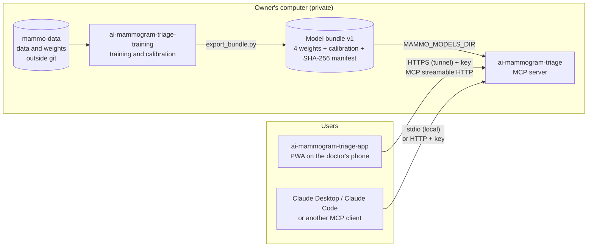
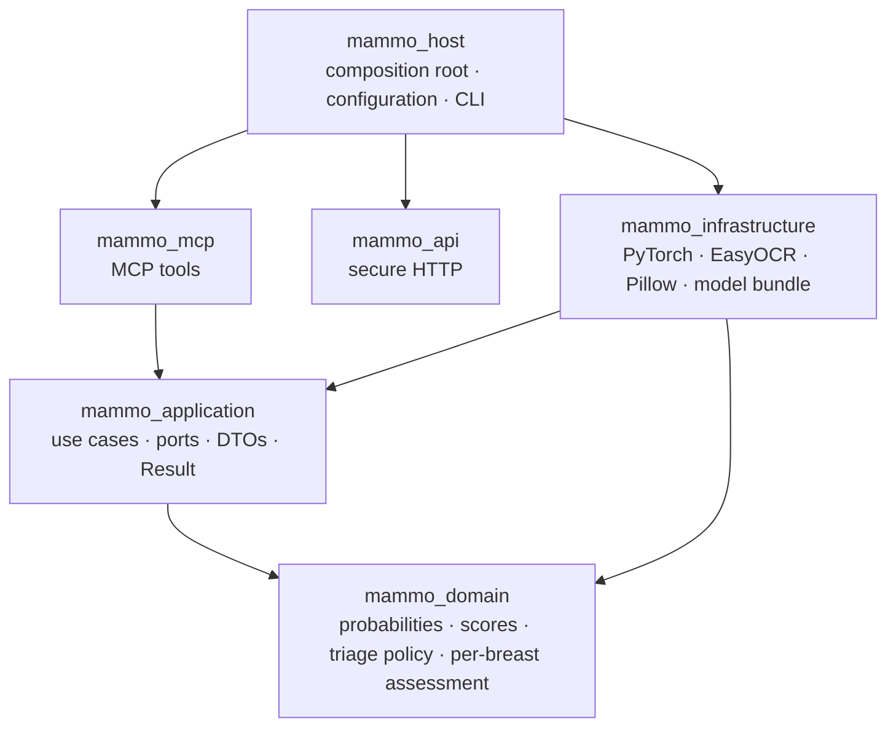
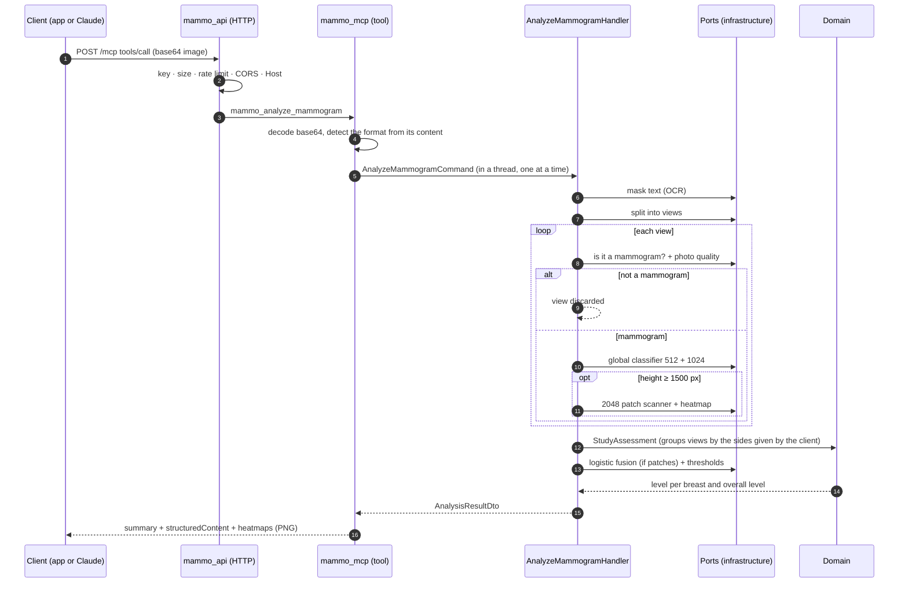
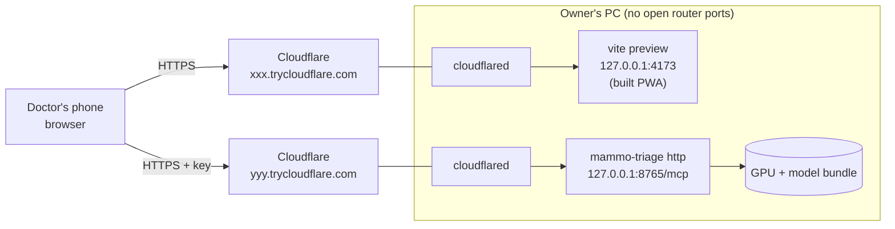

# Server architecture

This document explains how the server is built: the whole system, the code layers, the path of an image, the
deployment and each component.

## 1. The whole system

The project has three repositories.

| Repository | Visibility | Contents |
|---|---|---|
| `ai-mammogram-triage-training` | Private | The research: data, training, calibration and export of the model bundle |
| `ai-mammogram-triage` (this one) | Public | The MCP server that analyzes images with that bundle |
| `ai-mammogram-triage-app` | Public | The web app (PWA) for doctors, which talks to the server over MCP |

The model bundle never leaves the owner's computer. The weights were trained on VinDr-Mammo. Its PhysioNet data
use agreement does not allow redistributing them.

## 2. Code layers (onion architecture)

Each ring is a Python package in `src/`. Dependencies always point inwards. `lint-imports` (configured in
`pyproject.toml`) and `tests/architecture` check this on every test run.

`mammo_mcp` and `mammo_api` are independent siblings: `mammo_api` does not import `mammo_mcp`. `mammo_host`
builds the `MCPServer` object with `mammo_mcp` and passes it to `mammo_api`, which wraps it in the secure HTTP app.

| Ring | Responsibility | Must not import |
|---|---|---|
| `mammo_domain` | Business rules without technology: `Probability`, `BiradsProbabilities`, `SuspicionScores`, `TriageThresholds`, `TriagePolicy`, `BreastAssessment`, `StudyAssessment` | Anything outside the standard library |
| `mammo_application` | Use cases (`AnalyzeMammogramHandler`, `CheckIsMammogramHandler`, `MaskPersonalDataHandler`) and ports as `Protocol` (`PersonalDataMasker`, `PanelSplitter`, `MammogramGate`, `BiradsClassifier`, `ScoreFuser`, `ThresholdsProvider`). Expected errors use `Result` | numpy, torch, PIL, MCP, Starlette… |
| `mammo_infrastructure` | Implements the ports: safe decoding, preprocessing identical to training, filter, classifiers, OCR, logistic fusion and verified bundle loading. Its only public entry point is `create_ports()` | Presentation |
| `mammo_mcp` | The three MCP tools: argument validation, response format and coded errors | Infrastructure, numpy, torch, PIL |
| `mammo_api` | HTTP exposure: key, limits, CORS, *DNS rebinding* protection and `/health` | Infrastructure, ML |
| `mammo_host` | Reads the configuration, creates the ports, injects them into the use cases and starts stdio or HTTP | — |

One design decision matters: the domain does not know the models. It receives probabilities and scores that are
already computed, and it picks the level with thresholds. So the triage rules are tested without a GPU. A model
change does not touch the domain either: a new bundle with its own calibration is enough.

## 3. Path of an analysis

Views are grouped into one breast only when the client sends `sides` (R/L). There is no automatic side detection.
A view with an unknown side is evaluated alone, labelled "panel N".

## 4. Pilot deployment

`scripts/start_pilot.ps1` starts everything with one command and configures the server with the tunnel addresses.
Those addresses change on every start. Details are in [operations.md](operations.md).

## 5. Infrastructure components

| Component | File | What it does |
|---|---|---|
| Decoding | `ml/imaging.py` | Opens only PNG, JPEG, WebP, TIFF and BMP, with at most 60 MP, checked before decoding. Applies the EXIF orientation and converts 16-bit images to 8 bits by percentiles |
| Preprocessing | `ml/preprocessing.py` | Same as in training: inverts if the background is light, crops the breast, puts the chest wall on the left and centers it on a fixed-height canvas (512, 1024 or 2048 px) |
| Splitting into views | `ml/panels.py` | Detects separator columns, or splits into equal parts if the client gives `panel_count` |
| "Is it a mammogram?" filter | `ml/gate_model.py` | EfficientNet-B0 at 224 px with 3-variant TTA, plus the quality checks: minimum side, sharpness, burnt-out areas and breast fraction |
| Global classifier | `ml/classifiers.py` (`GlobalEnsemble`) | Mean of two EfficientNet-B0 models at 512 and 1024 px, with output `[P(1-2), P(3), P(4-5)]` |
| Patch scanner | `ml/classifiers.py` (`PatchScanner`) | 256 px windows with stride 128 over the breast at 2048 px; score = mean of the 2 most suspicious windows, plus the heatmap |
| Personal data | `ml/text_masking.py` | EasyOCR masks all text with confidence ≥ 0.3 and height ≤ 8 % of the image; it returns only counts |
| Fusion and thresholds | `_adapters.py` | Logistic regression on the *logits* of both models; thresholds depend on the mode (`fused` or `global_only`) |
| Model bundle | `bundle.py` | Checks the files and the SHA-256 of the manifest; weights are loaded with `weights_only=True` |
| Concurrency | `_adapters.py` and `mammo_mcp/server.py` | A single GPU lock and at most 3 requests in flight; beyond that the server answers `server_busy` |

How those outputs become levels: [scores-and-levels.md](scores-and-levels.md).
