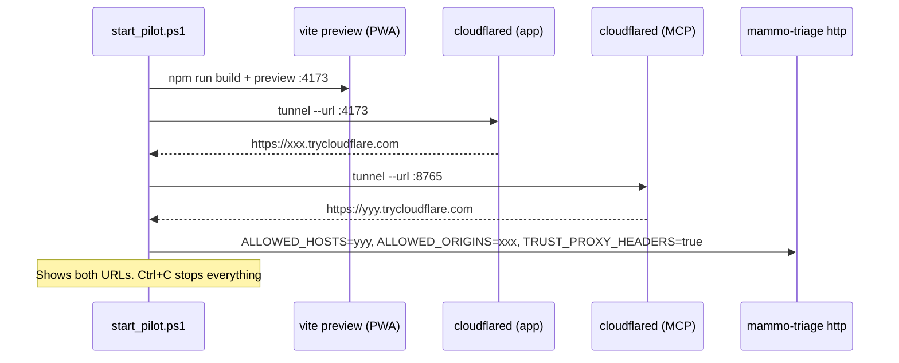

# Operations: install, configure, start and troubleshoot

This document explains how to get the server running, how to configure it, how to start the pilot and what to do
when something fails.

## 1. Requirements

- Windows 10/11 or Linux, with Python 3.11.
- NVIDIA GPU with CUDA (tested on an RTX 3050 with 6 GB). Without a GPU it runs on the CPU, but each analysis takes
  much longer.
- The **model bundle** (~65 MB) exported by the training repository:
  - `manifest.json`;
  - `gate.pt`, `global_512.pt`, `global_1024.pt` and `patch_2048.pt`;
  - `fusion_calibration.json`.
- For the remote pilot, `cloudflared` (Cloudflare's official executable). Verify its SHA-256 and its signature when
  you download it.

## 2. Installation

```bash
python -m venv .venv
```

```bash
.venv\Scripts\pip install torch==2.14.1 torchvision==0.29.1 --index-url https://download.pytorch.org/whl/cu126
```

```bash
.venv\Scripts\pip install -e ".[dev]"
```

On first use, EasyOCR downloads its text detection models.

## 3. Configuration (`.env` or environment variables)

| Variable | Default | Purpose |
|---|---|---|
| `MAMMO_MODELS_DIR` | (required) | Folder of the model bundle |
| `MAMMO_API_KEY` | (required for HTTP) | Shared key, ≥ 24 characters. Generate it with `mammo-triage new-key` |
| `MAMMO_DEVICE` | `auto` | `auto`, `cuda` or `cpu` |
| `MAMMO_VERIFY_BUNDLE` | `true` | Checks the SHA-256 of the weights at startup |
| `MAMMO_MAX_IMAGE_MB` | `10` | Maximum image size |
| `MAMMO_RATE_LIMIT_PER_MINUTE` | `60` | MCP requests per client per minute. One analysis costs about 3 |
| `MAMMO_ALLOWED_ORIGINS` | `http://localhost:5173` | App origins allowed by CORS, comma-separated |
| `MAMMO_ALLOWED_HOSTS` | `127.0.0.1:*,localhost:*` | Accepted `Host` values (*DNS rebinding* protection) |
| `MAMMO_TRUST_PROXY_HEADERS` | `false` | Use `CF-Connecting-IP` for the rate limit. Required with a tunnel |
| `MAMMO_HOST` / `MAMMO_PORT` | `127.0.0.1` / `8765` | Listening address. Do not change the host: use a tunnel |
| `MAMMO_LOG_LEVEL` | `info` | `debug`, `info`, `warning` or `error` |

`.env` is never committed. The template is `.env.example`.

## 4. Usage modes

### Local with Claude Desktop or Claude Code (stdio)

Add the server to the client's MCP configuration (see the [README](../README.md)). With stdio you can pass local
file paths (`image_path`).

### Local HTTP (for app development)

```bash
mammo-triage http
```

The server listens on `http://127.0.0.1:8765/mcp`, and `/health` answers `{"status":"ok"}`.

On Windows, `scripts/run_local.cmd` does the same with the settings in `.env`. It uses the Python in
`%MAMMO_PYTHON%`, or `%USERPROFILE%\.venvs\birads-poc\Scripts\python.exe` if that variable is not set.

### Remote pilot with HTTPS tunnels

In PowerShell:

```powershell
.\scripts\start_pilot.ps1
```

Parameters:

| Parameter | Default | Purpose |
|---|---|---|
| `-Cloudflared` | `%USERPROFILE%\tools\cloudflared\2026.10.0\cloudflared.exe` | Path of the `cloudflared` executable |
| `-Python` | `%USERPROFILE%\.venvs\birads-poc\Scripts\python.exe` | Python of the virtual environment where the server is installed |
| `-AppDir` | `ai-mammogram-triage-app`, sibling of this repository | Folder of the app repository (built and served with `vite preview`) |
| `-LogDir` | `%USERPROFILE%\mammo-data\logs` | Folder for the tunnel and PWA logs |

If the server is installed in another virtual environment, pass `-Python`, for example
`.\scripts\start_pilot.ps1 -Python C:\path\to\venv\Scripts\python.exe`. The script stops if `-Cloudflared` or
`-Python` does not exist.



Give the doctors:

1. The app URL.
2. The server URL (it ends in `/mcp`). They enter it in the app's **Settings** screen ("Ajustes" in Spanish) and
   press **Save and test connection**.
3. The key, **through a private channel**.

The app's routes and texts are in English by default, with a Spanish option.

Quick tunnels get a new URL on every start. A fixed URL needs a Cloudflare account and a named tunnel.

Do not leave test images in the app's `dist/` folder while the tunnel is open: everything there is public.

## 5. Common problems

The app messages below are the English texts; the Spanish option shows the equivalent text.

| Symptom | Likely cause | Fix |
|---|---|---|
| `MAMMO_API_KEY is required…` at startup | The key is missing, or shorter than 24 characters | Run `mammo-triage new-key` and put it in `.env` |
| `…TRUST_PROXY_HEADERS is false` at startup | There is a public host in `MAMMO_ALLOWED_HOSTS` | Set `MAMMO_TRUST_PROXY_HEADERS=true` |
| `Checksum mismatch for …` | Corrupt or modified bundle | Export it again from the training repository |
| The app says "The server rejects this connection" (421) | The tunnel host is not in `MAMMO_ALLOWED_HOSTS` | Use `start_pilot.ps1`, or add it by hand |
| The app says "The server could not be reached" | Server off, old tunnel URL, or origin not allowed by CORS | Check `/health`, the URL in Settings and `MAMMO_ALLOWED_ORIGINS` |
| "The access key is not valid" (401) | Wrong or rotated key | Check Settings |
| Frequent `server_busy` | Many analyses at once (one at a time on the GPU) | Wait a few seconds; with many doctors, consider another machine |
| Always `global_only`, no heatmap | Photos less than 1500 px high | Use the original image or closer photos |
| `start_pilot.ps1` says `Not found: …` | `cloudflared` or the Python venv is not at the default path | Pass `-Cloudflared` or `-Python` |
| The first analysis takes ~20 s | GPU and OCR warm-up | Normal; later ones are faster |

## 6. Logs

- The server writes to standard error. It does not log images, OCR text or tool arguments.
- `start_pilot.ps1` saves the tunnel and PWA logs in `-LogDir` (by default `%USERPROFILE%\mammo-data\logs`).
