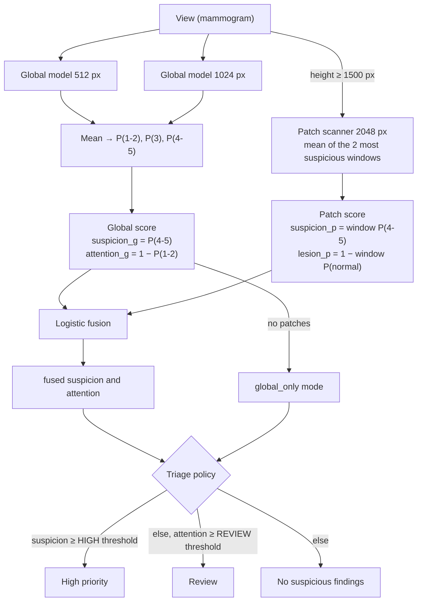

# Scores, levels and how to explain them

This document explains what each number in the result means, how it is computed and how a doctor should read it.

> ⚠️ The result is **indicative**. It helps decide which studies to read first. It is not a diagnosis. It never
> replaces the radiologist's reading. This is a research tool, not a medical device.

## 1. What the analysis returns

For each breast:

| Field | What it is | Example |
|---|---|---|
| `label` | Name of the breast: `right`, `left` or `panel N` (when the client gave no side for that view) | `left` |
| `side` | `R`, `L` or `unknown`, as given by the client in `sides` | `L` |
| `level` | Priority level: `high_priority`, `review` or `no_suspicious_findings` | `high_priority` |
| `probabilities` | Estimated probability of each BI-RADS group. They add up to 1 | `{birads_1_2: 0.13, birads_3: 0.04, birads_4_5: 0.83}` |
| `most_likely` | Most likely group | `BI-RADS 4-5` |
| `scoring_mode` | `fused` (global model + patches) or `global_only` (resolution too low for patches) | `fused` |
| `suspicion`, `attention` | Internal scores that decide the level (see §3) | `0.91`, `0.95` |
| `quality_issues` | Photo problems, each with a recommended action | `["blurry"]` |
| `views[]` | Detail per view, with a heatmap if there is one, or the reason there is none, and the most suspicious regions (see §4) | — |

For the whole study:

- `overall_level`: the most urgent level among the breasts.
- `rejected_panels`: the views discarded because they do not look like mammograms.
- `masked_text_regions`: how many text areas were masked.
- `model_version`: the version of the model bundle.

## 2. The BI-RADS groups

The model groups the BI-RADS categories into three groups, by the clinical action they imply:

| Group | Categories | Usual action |
|---|---|---|
| BI-RADS 1-2 | Negative / benign | Routine screening |
| BI-RADS 3 | Probably benign | Short-term follow-up |
| BI-RADS 4-5 | Suspicious / highly suspicious | Biopsy |

BI-RADS 0 (incomplete) and BI-RADS 6 (known cancer) were not used for training. Why this grouping was chosen:
[training repository docs](https://github.com/avalderrama/ai-mammogram-triage-training) (private).

## 3. How it is computed



### 3.1 Two scores for two different questions

- **Suspicion** (`suspicion`): "how much does it look like BI-RADS 4-5?". It decides **High priority**.
- **Attention** (`attention`): "how far is it from a normal study?". In the global model it is `1 − P(1-2)`, so it
  also rises with BI-RADS 3 findings. It decides **Review**.

Keeping them apart lets HIGH be strict (few false alarms) and REVIEW be broad (few missed cases).

### 3.2 Global model and patch model

- The **global model** sees the whole breast, resized to 512 and 1024 px high. It captures masses, asymmetries and
  distortions well. Microcalcifications are too small at that scale.
- The **patch model** scans the breast at 2048 px with 256 px windows. It finds small findings, such as
  calcifications, and produces the **heatmap**. It needs an image at least **1500 px high**: below that, upscaling
  adds no detail.

### 3.3 Fusion

When patches are available, both scores are combined with a **logistic regression** on their *logits*:

```
suspicion = σ( 1.013 · logit(P45_global)       + 0.744 · logit(P45_patches)    − 0.740 )
attention = σ( 1.300 · logit(attention_global) + 0.485 · logit(lesion_patches) − 1.608 )
```

`σ` is the logistic function. The coefficients were learned on one half of the patients in the official
VinDr-Mammo test split. Performance is reported on the other half (half B, §5). The fusion works on
absolute scores, not on ranks within a set, so it works for a single image.

### 3.4 Several views of the same breast

Views are combined into one breast **only when the client gives `sides`** (R/L), for example
`sides: ["R", "R"]` for RCC + RMLO. There is no automatic side detection. Then the **breast** is evaluated, not
each view:

| Score | How the views are combined |
|---|---|
| BI-RADS probabilities | Mean of the views |
| Global score | Mean of the views |
| Patch score | Maximum of the views: it is enough for the finding to show in one. If any view has no patches, the breast falls back to `global_only` |

Without `sides`, or with `unknown`, each view is evaluated as its own "breast", labelled `panel N`.

### 3.5 Thresholds

| Mode | HIGH threshold (suspicion ≥) | REVIEW threshold (attention ≥) |
|---|---|---|
| `fused` | 0.0783 | 0.0812 |
| `global_only` | 0.1973 | 0.2466 |

The thresholds look low because the fused scores are calibrated on a screening population, where BI-RADS 4-5 is
rare. What was fixed is the **behavior**, measured per breast:

- **HIGH**: ≈5 % false alarms (calibration target; 6.5 % of BI-RADS 1-2 breasts in the held-out half B).
- **HIGH + REVIEW**: together they flag 85 % of BI-RADS 4-5 breasts (calibration target; 87 % in half B).

The project owner chose this balance ("Keep the current balance").

## 4. How to read the result (for the doctor)

| Level | Icon | What to do |
|---|---|---|
| **High priority** | ⚠ triangle | Read this study first. The model sees findings it associates with BI-RADS 4-5 |
| **Review** | 👁 eye | Look at it carefully. It neither confirms nor rules out anything |
| **No suspicious findings** | ✓ circle | The model sees nothing suspicious. The reading is still needed |

- **Probabilities:** they are a model estimate, not a clinical probability calibrated for each patient. Use them to
  compare (93 % versus 5 %), not as an exact figure.
- **Heatmap:** in red, the areas that weighed most in the patch decision. It is not a segmentation of the lesion.
- **Quality warnings:**

  | Warning | Action |
  |---|---|
  | `low_resolution` | Move closer or use the original image |
  | `blurry` | Tap the breast on the phone screen to focus |
  | `glare` | Turn off lights that reflect on the screen and do not use the flash |
  | `small_breast` | Frame it better or crop |

  A photo with warnings may give a less reliable result.
- **Partial result:** a view was discarded, or only the global model was used. The app shows this.

### Where the model looks: suspicious regions

When the patch model runs (image at least **1500 px high**), each view also returns `regions`: up to **3** windows
where the patch model gave the highest P(4-5). They help the reader find, on the heatmap, the areas that weighed
most. How they are chosen:

1. Each 256 px window of the scan (on the breast resized to 2048 px high, windows with enough tissue only) has a
   patch P(4-5).
2. Windows are taken from the highest score down. A window is kept only if its score is at least **0.25** and it
   overlaps any window already kept by **25 % or less** (non-maximum suppression), so the three regions are not
   copies of the same spot.
3. The search stops at 3 regions or at the first window below 0.25. If no window reaches 0.25, the list is
   empty: no area stands out.

Each region has:

| Field | Meaning |
|---|---|
| `x`, `y`, `width`, `height` | The window's box, from 0 to 1, relative to the heatmap image. That image is the processed breast: cropped, with the chest wall on the **left** and the nipple towards the right |
| `score` | The raw patch-model P(4-5) of that window. It is **not calibrated** and is not the breast's probability. Use it only to rank the regions |
| `depth` | `posterior` (third nearest the chest wall), `middle` or `anterior` (third nearest the nipple). Measured at the window's center, from the chest wall to the furthest tissue on the nipple side |
| `vertical` | `upper`, `middle` or `lower` third of the height the breast tissue takes in the image |

The text summary names the first region of each view, for example "Most suspicious area (MLO): anterior third
(near the nipple), upper part of the breast" (in Spanish with `language: "es"`).

**What regions are not.** They are a reading aid, not a lesion segmentation or a detection. A box marks a whole
256 px window, not the outline of a finding. The model can point at normal tissue, and a finding can lie outside
every box. The level of the breast does not depend on the regions. The positions are thirds of the breast **as it
appears in this view**: in an MLO view "upper" is not the same as anatomically superior, so do not read them as
clock positions or quadrants. In `global_only` mode (image below 1500 px) there is no heatmap and `regions` is
empty.

In a check on one VinDr-Mammo BI-RADS 5 case, the first region fell on the mass annotated by the radiologist. That
is one example, not a validation of the regions.

### Plain-language explanation (performance)

On the half of the VinDr-Mammo patients not used for calibration (half B), with good-resolution images, counting
**breasts**:

- Of every 100 breasts with **BI-RADS 4-5** findings: ~70 come out as *High priority*, ~17 as *Review* and ~13 as
  *No suspicious findings*. So 87 of every 100 are flagged.
- Of every 100 **normal or benign (BI-RADS 1-2)** breasts: ~72 come out as *No suspicious findings*, ~21 as
  *Review* and ~7 (6.5 %) as *High priority* (false alarms).
- With low-resolution photos (global model only): 4-5 → 53 / 30 / 17 and 1-2 → 3 / 29 / 68.

This has **not** been validated with photos of screens or films in real conditions, nor on populations other than
the Vietnamese population of VinDr. What is known about photos is in the training repository documentation.

## 5. Source of the figures

| Figure | Source |
|---|---|
| Coefficients and thresholds | `fusion_calibration.json` in the bundle (generated by `calibrate_fusion.py`) |
| Distributions by level | `half_b_report` in the same file: half B of the patients, seed 2026 |
| AUC BI-RADS 4-5 (fusion, half B) | 0.891 |
| AUC BI-RADS 4-5 (global only, half B) | 0.826 |
